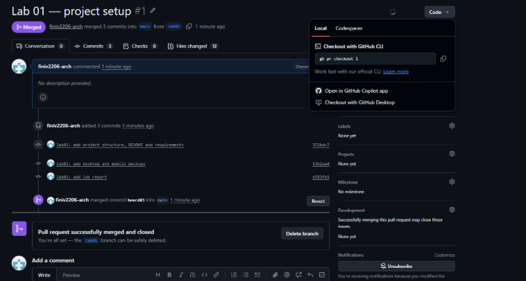
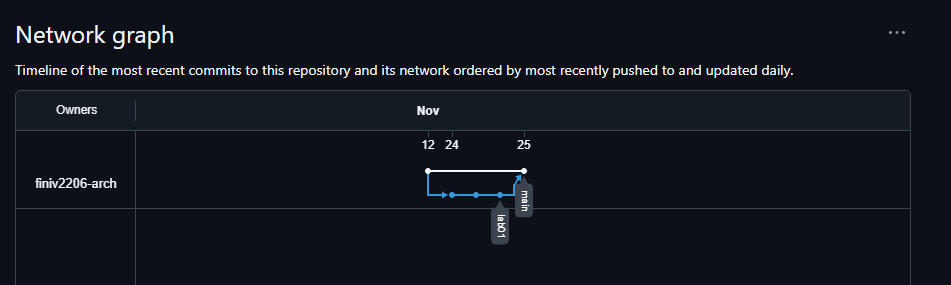
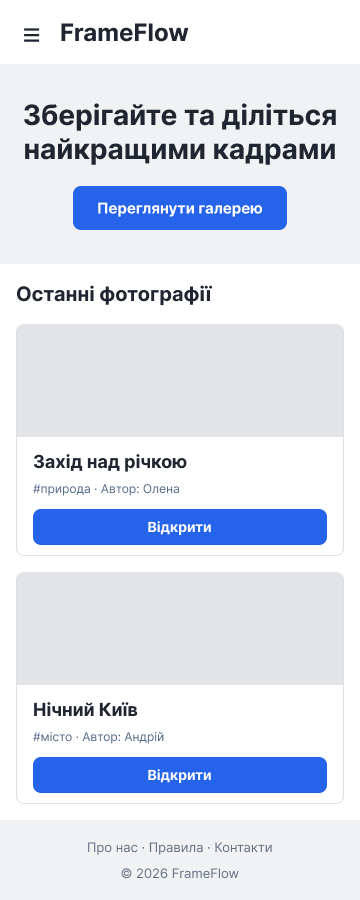

# Звіт з лабораторної роботи № 1

**Дисципліна:** Сучасні Web-технології  
**Тема:** Визначення власного об’єкта дослідження (наскрізна задача). Структура веб-проєкту та організація репозиторію GitHub  
**Виконав:** студент групи КІ-24 Фінів Артем Васильович  
**Варіант:** 15 («Онлайн-галерея фотографій»)  

## 1. Мета роботи
Обрати предметну область наскрізного проєкту, сформулювати вимоги до нього, спроєктувати структуру веб-застосунку, створити макети сторінок та організувати репозиторій GitHub для поетапної розробки проєкту протягом семестру.

## 2. Постановка завдання (Варіант 15)
Розробити концепцію та підготувати інфраструктуру для веб-застосунку **«Онлайн-галерея фотографій»** (FrameFlow).  
Основні сутності предметної області: `user`, `album`, `photo`, `tag`.

## 3. Хід виконання роботи
1. Налаштовано локальний Git (`user.name`, `user.email`, гілка за замовчуванням `main`).
2. Створено публічний репозиторій `FrameFlow` на GitHub із файлами `README.md` та `.gitignore` і клоновано його локально.
3. Сформовано структуру каталогів проєкту (`docs/mockups`, `src/pages`, `src/css`, `src/js`, `src/assets/img`, `labs/lab01`).
4. Складено документ вимог у файлі `docs/requirements.md` з описом ролей, сутностей, зв'язків, сторінок та функціональних вимог.
5. Розроблено адаптивні макети головної сторінки у Figma для desktop (`1280 px`) та mobile (`360 px`).
6. Створено гілку `lab01`, виконано серію змістовних комітів, відправлено зміни на GitHub та виконано злиття з гілкою `main` через Pull Request.

## 4. Результати та скріншоти
- **Посилання на репозиторій:** https://github.com/finiv2206-arch/FrameFlow

### Головна сторінка репозиторію з оформленим README

### Граф гілок та комітів (Insights → Network)

### Макет головної сторінки (Desktop, 1280 px)

### Макет головної сторінки (Mobile, 360 px)

## 5. Висновки
У ході виконання лабораторної роботи було визначено предметну область наскрізного проєкту («Онлайн-галерея фотографій»), сформовано технічні вимоги, розроблено макети інтерфейсу та налаштовано робоче середовище з використанням системи контролю версій Git і сервісу GitHub.